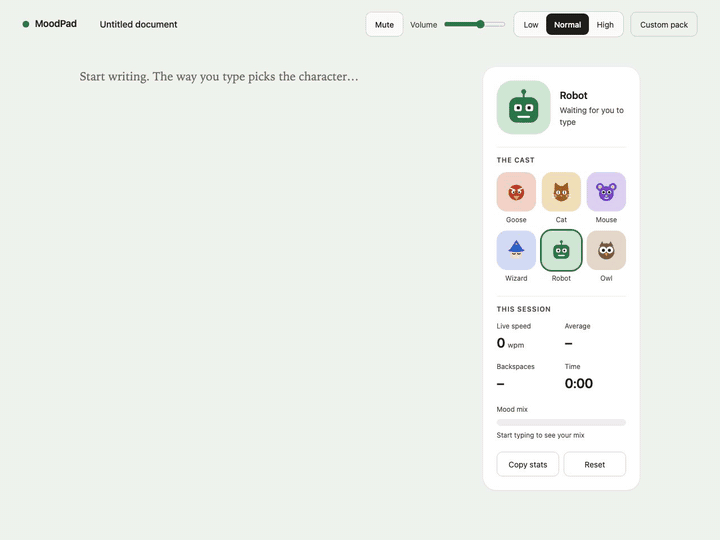
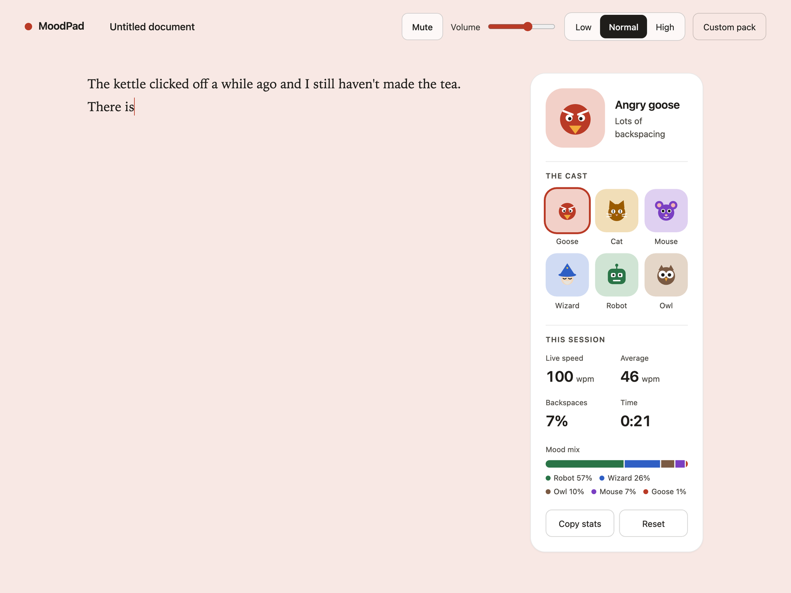
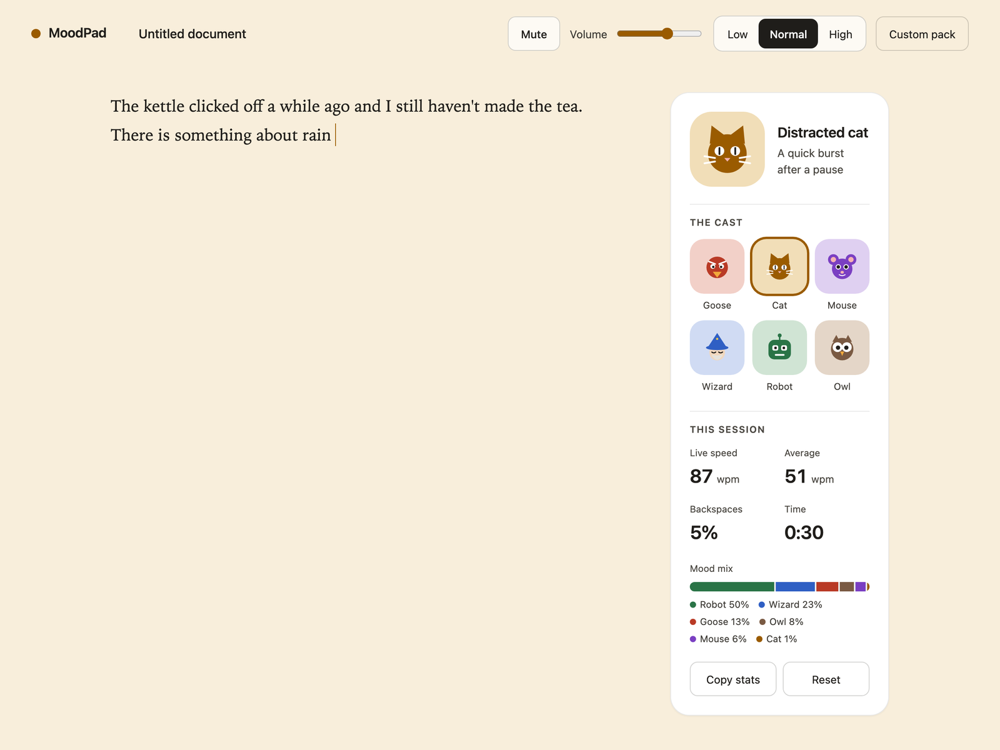
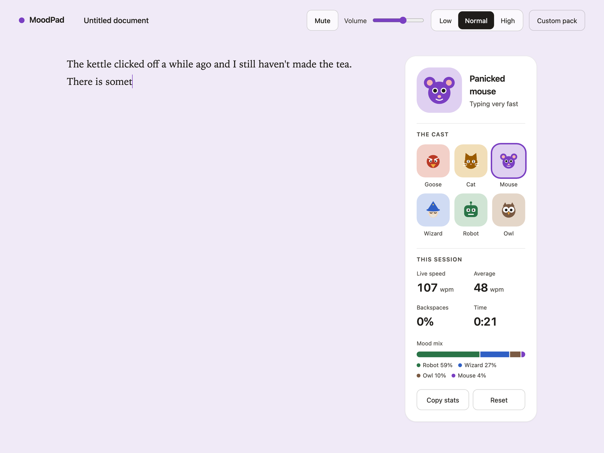
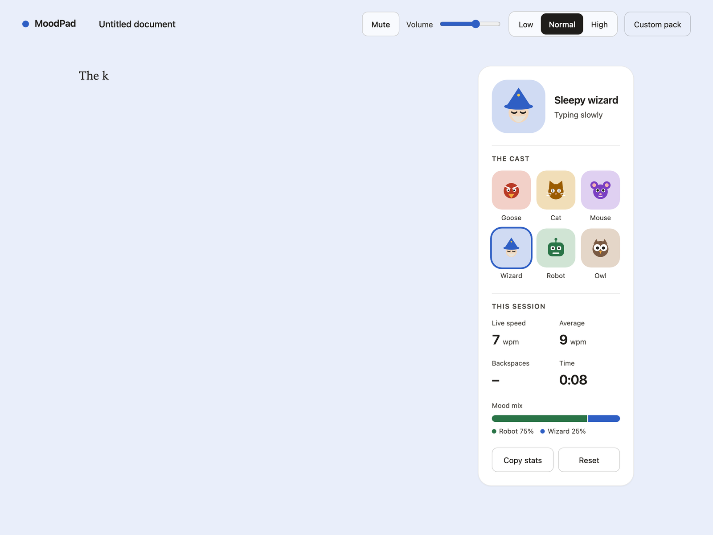
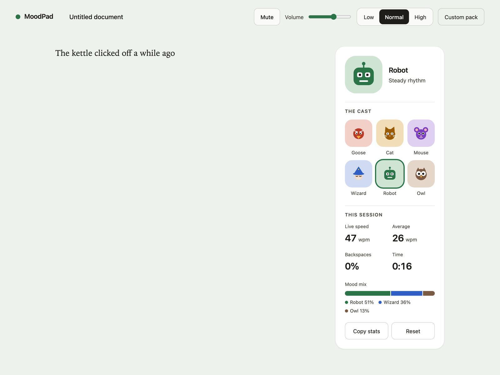
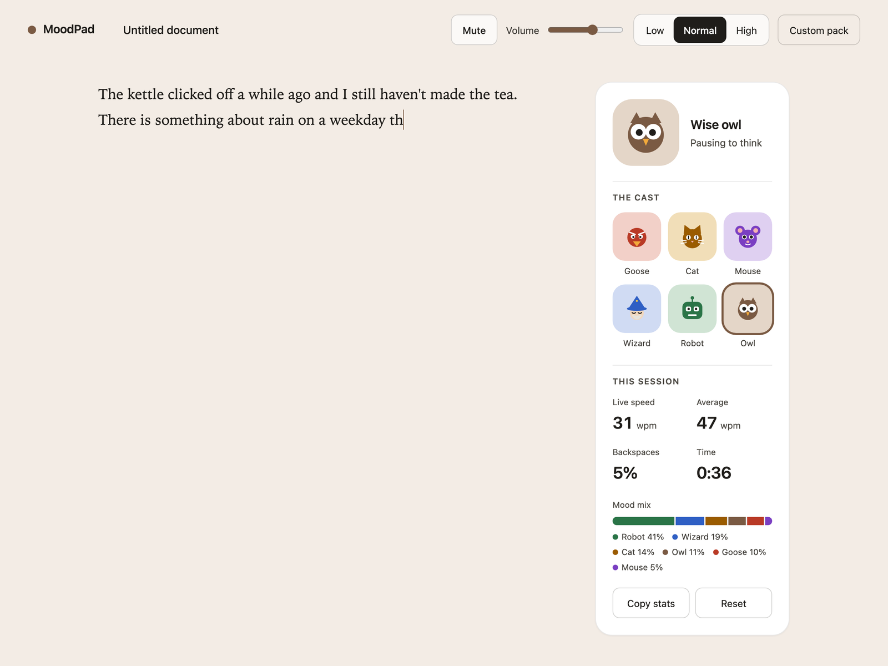

# MoodPad

Free writing, with feelings. A distraction-free writing pad whose characters and sounds react to *how* you type, never *what* you type.



*Silent preview. [Watch the demo with sound](docs/demo.mp4).*

**Try it: [yasserjamal.com/moodpad](https://yasserjamal.com/moodpad)**, or open `index.html` from a clone. There's no install, no build step and no server.

## The cast in action

| | | |
| --- | --- | --- |
|  |  |  |
| **Angry goose**: backspacing or shouting | **Distracted cat**: a burst after a pause | **Panicked mouse**: very fast typing |
|  |  |  |
| **Sleepy wizard**: slow, unhurried | **Robot**: steady rhythm | **Wise owl**: pausing to think |

The page before you start typing: [docs/screenshots/empty.png](docs/screenshots/empty.png).

## Characters

MoodPad looks at a rolling 6-second window of your typing and picks a character. Rules are checked top to bottom; the first match wins.

| Character | When it shows up | Sound personality |
| --- | --- | --- |
| Angry goose | More than 30% backspaces, or more than 60% capitals, in the last 12 keys | Honks, an angry hiss on backspace (and as its entrance) |
| Distracted cat | A quick burst (3 to 25 keys, under 220 ms apart) right after a pause of 2.5s or more | Chirps, a purr, a meow on the first key of each burst |
| Panicked mouse | Faster than 75 wpm | Tiny squeaks and scurrying ticks |
| Sleepy wizard | Slower than 12 wpm | Sleepy mumbles, soft magical chimes, a yawn |
| Robot | Steady rhythm at 25 wpm or more (also the fallback) | Digital beeps, servo whirr, a two-tone acknowledgment |
| Wise owl | A pause of 700 ms or more in the window, or an uneven rhythm | Soft hums, a hoot on space, a double hoot |

A new character has to keep winning for 1.5 seconds before it takes over, so it doesn't flicker. The goose is the exception and shows up immediately. When a character takes over it plays a signature sound. Every threshold lives in one object, `DEFAULT_CONFIG`, in [`mood-engine.js`](mood-engine.js); the Low / Normal / High sensitivity control scales them.

## Stats

The "This session" panel shows live speed, average speed (pauses over 3 seconds don't count), backspace rate, time, and a bar of how your time split across characters. The footer shows words, characters and reading time. Stats are computed from key timing and key categories only, kept in memory, and cleared with **Reset** or a refresh. **Copy stats** puts a one-line numbers-only summary on your clipboard.

## Privacy

- Each keystroke becomes only a **timestamp and a category** (letter, capital letter, backspace, space, enter, other). The engine never sees which key it was.
- The one place a key's identity is read is the [`categorize` function in `index.html`](index.html#L355). It turns the key into a category and a small pitch offset, and keeps neither the key nor its code.
- The page makes no network requests: no analytics, no fonts, no uploads. Sounds are bundled in [`sounds.js`](sounds.js).
- Your text, title and settings are autosaved in your browser's local storage on your own device. Session stats are not saved. Custom sound packs are not saved.

## Custom sound packs

Click **Custom pack** and pick a folder containing a subfolder per character (`goose`, `cat`, `mouse`, `wizard`, `robot`, `owl`):

```
my-pack/
  cat/
    signature.wav   # plays when the cat takes over
    key_1.wav       # any key_*.wav files; one is picked at random per key
    key_2.wav
    first.wav       # optional: first key of a burst
    backspace.wav   # optional
    space.wav       # optional
```

A character needs `signature.wav` and at least one `key_*.wav`, otherwise it keeps its default sounds. Packs last for the current session. Files stay on your device.

## Develop

```sh
make test     # engine tests (Node 18+, no dependencies)
make open     # open index.html
make sounds   # regenerate the WAVs (needs numpy) and rebuild sounds.js
```

`mood-engine.js` has no DOM dependency and is shared by the page and the tests. See [CONTRIBUTING.md](CONTRIBUTING.md).

## Licenses

Code: [MIT](../LICENSE). Bundled sounds: [CC0 1.0](sounds/LICENSE), all generated by [`scripts/generate_sounds.py`](scripts/generate_sounds.py) and listed in [`sounds/manifest.json`](sounds/manifest.json).
